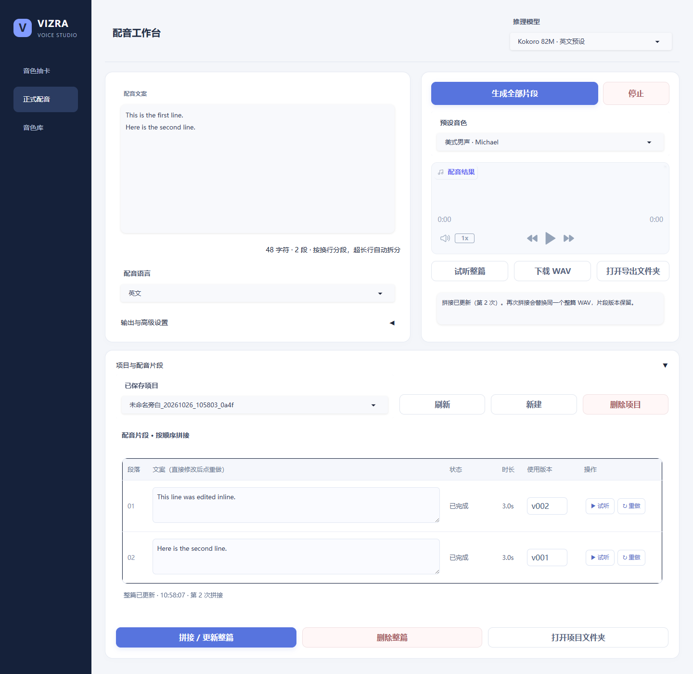

# Vizra Voice Studio

**把一篇文案，做成一条满意的旁白。**

简体中文 · [English](docs/README.en.md)

[下载预览版](https://github.com/Nitric-acid-CN/Vizra-Voice-Studio/releases) · [使用流程](#配音流程) · [模型选择](#选择模型) · [实测与示例](docs/VALIDATION.md)

面向视频创作者的本地中文 / 英文配音工作台。先找一个喜欢的声音，再把文案按行生成；哪一段不满意，就只重做那一段。满意后导出 WAV，继续在 Premiere Pro 等剪辑软件中制作。

**开源预览版 0.2.0 · Windows / NVIDIA 优先 · 中文界面，中文与英文配音。**

| 找声音 | 做旁白 | 改细节 | 交给剪辑 |
| --- | --- | --- | --- |
| 短句抽卡，逐个试听、命名收藏 | 粘贴文案，每个非空行是一段 | 表格内改稿、试听、重做、选版本 | 拼接成 48kHz 无损 WAV |

这是一套围绕官方开源语音模型构建的创作工具。每次只加载一个模型、顺序生成，适配显存有限的电脑。网页固定监听 `127.0.0.1`，模型和创作内容保存在本机。



## 开始使用

**第一次使用：** 前往 [Releases](https://github.com/Nitric-acid-CN/Vizra-Voice-Studio/releases)，下载名称含 `Windows` 的预览包，解压到独立目录，例如 `F:\AI\Vizra-Voice-Studio`。

> **先准备 Python 3.12 和 NVIDIA 驱动。** 下载包不含模型或完整运行环境；第一次安装需要联网。模型及依赖安装齐全后，日常配音可以离线使用。

已部署的电脑：双击目录中的 **Vizra-Voice-Studio.exe**，启动器可打开网页、打开输出文件夹及关闭服务。
关闭启动器会停止服务并释放模型，作品与收藏保留。唯一备用脚本为 `start.bat`。

首次从源码安装：Windows 10/11 x64、Python 3.12、NVIDIA 驱动、足够磁盘空间；推荐 16GB 内存。
6GB 显存已有本机测试，具体模型结果见 [实测报告](docs/VALIDATION.md)。首次安装需联网，之后所需文件已齐全时可离线推理。
默认两套 Qwen 权重加主环境约需数 GB；基础及英文安装建议预留 25GB，全部引擎建议预留 40GB。

Windows 预览包附带 EXE：安装好 Python 3.12（勾选 Launcher / 添加到 PATH）后，
双击 EXE 可打开首次安装窗口，选择可选引擎并查看进度。纯源码也可使用 Python 3.12 打开
`setup_gui.pyw`。EXE 不捆绑 Python 或模型，安装不会在后台自动替你升级系统 Python。

<details>
<summary>偏好命令行？展开查看源码安装方式</summary>

在解压后的项目目录打开 PowerShell：

```powershell
# 若 python 不是 3.12，请把 -Python 改成 Python 3.12 的完整路径。
powershell -NoProfile -ExecutionPolicy Bypass -File .\setup.ps1 -Python python

# 可选：增加 CosyVoice（独立环境）。
powershell -NoProfile -ExecutionPolicy Bypass -File .\setup.ps1 -Python python -InstallCosy

# 可选：增加 Chatterbox + Kokoro 英文环境；已有主环境时只装英文。
powershell -NoProfile -ExecutionPolicy Bypass -File .\setup.ps1 -Python python -EnglishOnly
```

</details>

安装脚本只写入本目录的虚拟环境与模型，不修改其他项目的 Python、CUDA、PyTorch。
主环境与 CosyVoice 使用现有固定依赖；英文使用独立固定依赖。安装结束会检查 CUDA。
源代码安装脚本尚未在第二台干净电脑上完整验证，安装故障请附脱敏日志报告。

## 配音流程

**声音探索 → 保存音色 → 分段生成 → 局部修改 → 导出旁白**

1. **找声音**：右上角选 VoiceDesign，在“音色抽卡”输入短句与声音描述，逐条生成 1、3 或 5 个候选。选择列表试听，满意后命名收藏。
2. **做旁白**：切到“正式配音”，选参考克隆模型和收藏声音，粘贴文案。每个非空行是一段，超长行再按句子/词边界拆分。最多 12000 字符，建议先用短稿确定声音。
3. **一键生成**：点击“生成全部片段”，逐段保存并自动拼接。中断后原稿、模型、声音保持一致时，再次生成会跳过已有片段。
4. **局部修改**：在片段表格里改文案并点该行“重做”。其他段落保留；每行有试听、生成状态、历史版本下拉框，选择即决定拼接使用哪版。
5. **导出**：点击“拼接 / 更新整篇”替换同一个整篇文件，显示更新时间与拼接次数。“下载 WAV”或“打开导出文件夹”取出文件。

已完成音频不会因后台继续生成而自动切换播放。新项目可点击“新建”；原项目仍保留。
未提交的行内修改暂存在当前浏览器，点重做成功后才进入项目，请勿把临时草稿当成已保存版本。

## 选择模型

| 模型 | 语言（当前工作台开放） | 声音来源 | 适合什么 |
| --- | --- | --- | --- |
| Qwen VoiceDesign 1.7B | 中文、英文 | 文字描述 | 设计新声音、短句抽卡 |
| Qwen Base 0.6B | 中文、英文 | 收藏参考音频与对应文案 | 复用声音、低显存旁白 |
| CosyVoice3 0.5B | 中文、英文 | 收藏参考音频与对应文案 | 换一种克隆模型试听 |
| Chatterbox-Turbo | 英文 | 收藏参考音频 | 英文克隆，保留官方 Perth 水印 |
| Kokoro 82M | 英文（美式/英式） | 六个预设音色 | 快速生成，无需参考音频 |

VoiceDesign 按描述/随机采样生成，**收藏种子或描述不能锁定声音**；正式复用需参考克隆模型。
不同模型的能力不相同：英文引擎不会出现中文选项，Kokoro 不显示参考克隆控件；不支持的参数不会展示。
同一段参考音频换模型或跨语言，音色、口音和自然度可能变化，必须试听确认，不能保证完全一致。
当前不做全自动翻译；英文版本需要输入英文文案。英文自然度请先听公开测试样本再判断。

## 在 6GB 显卡上表现如何？

本机 RTX 3060 Laptop 6GB 已跑通五个模型的英文 CUDA 生成，以及中文回归。以下为短句测试，推理时间不含加载模型：

| 英文引擎 | 生成音频 | 推理时间 | 峰值分配显存 |
| --- | ---: | ---: | ---: |
| Qwen VoiceDesign | 5.36 秒 | 11.41 秒 | 4.05 GiB |
| Qwen Base | 5.04 秒 | 12.18 秒 | 2.36 GiB |
| CosyVoice3 | 6.68 秒 | 5.81 秒 | 3.28 GiB |
| Chatterbox-Turbo | 5.28 秒 | 14.79 秒 | 2.73 GiB |
| Kokoro | 7.05 秒 | 1.52 秒 | 0.67 GiB |

这些是这台电脑的实测，不是所有硬件和长稿的性能承诺。查看 [完整条件与样本](docs/VALIDATION.md)，先试听再决定适合自己的声音。

## 文件与收藏

```text
outputs/
  candidates/       抽卡候选，每次保留独立版本
  favorites/        收藏 WAV 与文案、参数、模型等 JSON
  segments/         项目及每段独立 WAV / 历史版本
  final/            整篇旁白
  preferences.json  上次音色、模型、预设选择
```

- 单段保存 PCM WAV；整篇通过实际重采样导出 **48kHz、24-bit PCM WAV**，不伪改采样率。
- 改段落或版本后显示“需要重新拼接”，点击拼接更新。删除整篇不删除片段。
- 删除项目会先列出本地文件数量，确认后永久删除对应片段及整篇；收藏保留。
- 音色可重命名、删除、撤销。音色删除是可撤销列表移除，保留文件以保护旧项目。
- 更换目录可修复应用自有输出记录的旧路径；Python 虚拟环境不能当作跨电脑通用绿色环境。
- 用户完整备份包含个人声音与项目，**不能作为公开开源包上传**。

## 开源与限制

本项目代码采用 [MIT](LICENSE)。模型、引擎、依赖各自遵循上游许可证，见 [第三方说明](THIRD_PARTY.md)。
源码不附模型、虚拟环境或用户音频；公开示例只使用专门生成的测试声音。

已知范围：Windows/NVIDIA 优先，无多轨时间线、字幕对齐、视频自动翻译、自动转录导入或 Mac/Linux 安装保证。
EXE 是启动器，不是打包全部依赖的一体安装器。短句生成成功不代表任意长稿绝不漏读或声音永不变化。

[功能对比](docs/COMPARISON.md) · [实测记录](docs/VALIDATION.md) · [参与开发](CONTRIBUTING.md) · [隐私与安全](SECURITY.md)

开发检查：`python -m unittest discover -s tests -v`。CI 只检查 CPU 工作流，不伪造 GPU 兼容认证。
诊断：`.\.venv\Scripts\python.exe diagnose.py`。日志位于 `logs/`，发布问题前请脱敏。
